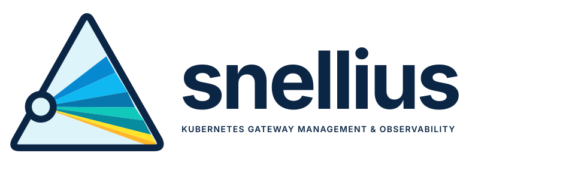

<h1 align="center">
  <picture>
    <source media="(prefers-color-scheme: dark)" srcset="docs/assets/snellius-logo-horizontal-dark.svg">
    <source media="(prefers-color-scheme: light)" srcset="docs/assets/snellius-logo-horizontal-light.svg">
    
  </picture>
</h1>

<p align="center"><strong>See the whole picture.</strong><br>Kubernetes Gateway Management &amp; Observability</p>

Snellius is a read-only UI for Kubernetes Gateway API, built for kgateway. It shows the health of each controller install at a glance, why an install is unhealthy, and an inventory of what it manages: GatewayClasses, Gateways, routes and policies.

Kubernetes is the only provider today. The API and the SPA are built so other platforms can be added later.

**Naming.** The name Snellius is not trademark-cleared. SURF's Dutch national supercomputer is also named Snellius.

## Why Snellius?

Snellius is named after [Willebrord Snellius](https://en.wikipedia.org/wiki/Willebrord_Snellius) (1580–1626), a Dutch mathematician and astronomer known for Snell's law of refraction and his pioneering work in triangulation and navigation. Just as Snellius used observations from multiple points to understand and map the physical world, this project brings together Kubernetes Gateway API resources, controller state, proxy configuration, and runtime telemetry to provide a coherent picture of gateway infrastructure. The connection to refraction is equally fitting: understanding how traffic is directed and transformed as it flows through different layers of the system. Snellius helps operators see the whole picture, from configuration intent to actual dataplane behavior.

## Security and trust model

Read this before you expose the UI.

- **No login in this release.** Whoever can reach the UI sees everything it shows. That is everything its ServiceAccount can read across the cluster, Deployments included. It can be more than the viewer's own Kubernetes RBAC allows, as in Argo CD.
- **No Secrets.** The UI never reads Secrets, and its ClusterRole excludes them. No other field is redacted, because a secret can sit in any field, such as an inline token or a literal env var.
- **Port-forward by default.** The chart creates a ClusterIP Service only. The optional `httpRoute` (off by default) is for operators who put authentication and authorisation on that route, for example a kgateway TrafficPolicy with OIDC or external auth.
- **Per-user authorisation plugs into a seam.** Downstream builds and future releases add it through `api.Authorizer` (`extension.WithAuthorizer`). A finding on a resource the viewer may not see is shown as restricted, and the health state still counts it. Per-user authentication and authorisation is on the [roadmap](docs/roadmap.md).

## Install

```sh
# Install the chart from ghcr
helm install ui oci://ghcr.io/duncandoyle/charts/snellius --version 0.5.0 \
  -n snellius --create-namespace

# Open the UI on http://localhost:8080
kubectl -n snellius port-forward svc/ui-snellius 8080:80
```

The image is `ghcr.io/duncandoyle/snellius`. Installing from a checkout needs `--set image.tag=<version>`; see the [chart README](deploy/helm/snellius/README.md#install). To pin the UI to one install, set `install.pin`. To expose it through a Gateway, read [Security and trust model](#security-and-trust-model) first, then set `httpRoute.enabled`, `httpRoute.parentRefs` and `httpRoute.hostnames`. The [chart README](deploy/helm/snellius/README.md) lists every value.

## Run locally

```sh
# Build the SPA and the binary with the SPA embedded
make build

# Serve on http://127.0.0.1:8080 against your current cluster
./bin/snellius --kubeconfig ~/.kube/config
```

Flags:

- `--kubeconfig`: path to a kubeconfig; empty uses in-cluster config, else the default loading rules.
- `--install`: pin the UI to one install (install ID or `namespace/name`).
- `--listen`: listen address (default `:8080` in-cluster, `127.0.0.1:8080` locally).
- `--poll-interval`: maximum time between model recomputes, the safety timer (default 30s). The model recomputes on object, access, metrics and served-kind changes; `2s` restores the earlier fixed cadence as a floor.
- `--metrics-interval`: controller metrics scrape interval (default 10s).
- `--delegation-edge-cap`: selected delegation edges computed per install (default 10000; 0 keeps the default). Past the cap, parents read "too large to compute". A higher cap needs a higher memory limit.
- `--class-only-installs`: also show one install per GatewayClass `controllerName` that no detector recognises, from Gateway API status alone (default off; chart value `installs.classOnly`).

`make test`, `make lint` and `make e2e` run the Go tests, the linters and the kind end-to-end suite. `make help` lists all targets.

## What it reads

- **Read-only RBAC.** The ClusterRole grants only `get`, `list` and `watch`: Gateway API kinds, all `gateway.kgateway.dev` kinds, namespaces, pods, Deployments, Warning Events, Gateway API CRD metadata, ReferenceGrants, and Services and EndpointSlices. Each of the last three has a chart toggle. `diagnostics.controllerLogs` (off by default) adds `get` on `pods/log` in the controller namespace.
- **No Secrets, no ConfigMaps, no `*/proxy`, no `pods/portforward`.**
- **Controller metrics on port 9092.** In-cluster, the UI scrapes the controller pods directly. If a NetworkPolicy blocks that, the UI reports the signal as unavailable instead of green. Locally, it goes through the pods/proxy API with your kubeconfig's permissions.

## About page

Click the info icon left of the theme button in the header to open the About page. It shows the UI version, each watched install with its version and controller, and links to the source, docs and licence. A downstream `Brand` can set `descriptor` and `tagline` for the lines under its name, and `links` for its own Project links; without `links` the page shows a small "Built on Snellius" link.

## Scope

The UI honours the controller's `discoveryNamespaceSelectors`. It only counts resources in namespaces the controller watches, and the install page shows the scope as "N of M namespaces".

## Findings

[docs/findings.md](docs/findings.md) has one entry per finding code: its cause, its evidence and how to fix it. "Learn more" on a finding's page opens that entry. A `since` the UI derives resets when the UI restarts.

## Extending

Downstream builds extend the UI without forking it. The backend takes options from `pkg/extension`. This is [examples/downstream/main.go](examples/downstream/main.go), which the test suite builds and runs; the types it names are in [acme.go](examples/downstream/acme.go):

```go
package main

import (
	"context"
	"embed"
	"io/fs"
	"log"
	"net/http"
	"time"

	"k8s.io/utils/clock"

	"github.com/DuncanDoyle/snellius/pkg/api"
	"github.com/DuncanDoyle/snellius/pkg/app"
	"github.com/DuncanDoyle/snellius/pkg/extension"
	"github.com/DuncanDoyle/snellius/pkg/objects"
)

//go:embed all:dist
var dist embed.FS

func main() {
	ui, err := fs.Sub(dist, "dist")
	if err != nil {
		log.Fatal(err)
	}
	if err := app.Run(context.Background(), "", options(ui), extensions(clock.RealClock{})...); err != nil {
		log.Fatal(err)
	}
}

// options are the backend settings. Both intervals must be positive; these
// are the stock binary's defaults.
func options(ui fs.FS) app.Options {
	return app.Options{UI: ui, PollInterval: 30 * time.Second, MetricsInterval: 10 * time.Second}
}

// extensions are what this build adds to the stock UI. The types are in
// acme.go; clk drives the collector, so tests can step it.
func extensions(clk clock.WithTicker) []extension.Option {
	return []extension.Option{
		// Watch, count and serve an extra policy kind
		extension.WithKinds(acmePolicy),
		// Decide per request what the caller may see
		extension.WithAuthorizer(api.AuthorizerFunc(func(r *http.Request, ref objects.Ref) bool {
			return ref.Namespace != "acme-system"
		})),
		// Replace the upstream GatewayParameters resolution
		extension.WithProxyModeResolver(acmeProxyMode{}),
		// Publish a value between recomputes, for checks to read
		extension.WithCollectors(&acmeWidgets{clock: clk}),
		// Add checks; their finding codes start with ACME-
		extension.WithChecks("ACME-", acmeWidgetCheck{}),
		// Serve endpoints under /api/ext/acme/
		extension.WithHandlers("acme", acmeHandlers),
		// Report a feature's state in /api/v1/meta
		extension.WithCapabilities(acmeCapabilities),
	}
}
```

The other options are `WithDetectors`, `WithScopeProvider`, `WithScopeVerifier` and `WithComputedRules`.

- **Checks.** `WithChecks` takes a finding-code prefix, such as `ACME-`. It is a capital letter, then one to fifteen capitals or digits, then a dash. Each prefix registers once, and `KGWUI-` is reserved. A bad or repeated prefix makes `app.Build` fail.
- **Endpoints.** `WithHandlers("acme", …)` serves its routes under `/api/ext/acme/`, so they never collide with API v1. `Deps.Current` returns the published model. Filter objects with `api.Visible`, and reply with `api.WriteJSON` and `api.WriteError`.
- **Collectors.** `WithCollectors` starts each collector with the app. It publishes values through `Deps.Publish(key, value, fingerprint, ttl)` or marks them failing with `Deps.Fail`. A check declares the keys it reads as `<collector>/<key>` in `Inputs().Collected` and reads them with `ctx.Collected(key)`. A new fingerprint triggers a recompute. An expired value, or one from a stopped collector, reads as unavailable.
- **Capabilities.** `WithCapabilities` adds entries to `capabilityStates` in `/api/v1/meta`. A state is `on`, `off`, `denied` or `failing`. Names must not clash with core ones.

Kinds added with `WithKinds`, and anything a collector reads, need matching rules in the chart's ClusterRole. Add them with `rbac.extraRules`, as [values-acme.yaml](examples/downstream/chart/values-acme.yaml) does. The chart also takes `extraEnv`, `extraVolumes`, `extraVolumeMounts` and `extraContainers`.

A one-shot caller, such as a CLI or a test, builds its own configuration with `pkg/setup` and runs `cache.Start(ctx)` itself. Cancel `ctx` when done, then call `Cache.Wait()`: it returns once every goroutine `Start` launched has exited. Called before `Start` or a second time, it returns at once.

The frontend renders `Shell` from `@snellius/shell` with a `ShellExtension`. `make shell-pack` builds the package as a tarball, and each release attaches it. Its JS uses extensionless imports, so build the app with a bundler such as Vite. [examples/downstream/web](examples/downstream/web) installs the tarball and tests against it; run it with `make example-web`.

```tsx
import { defaultPages, renderWhenFontsReady, Shell, type ShellExtension } from "@snellius/shell";

const acme: ShellExtension = {
  // Product identity in the header
  brand: { productName: "acme", logo: null },
  // Render extra detail for findings from acme's own checks
  findingRenderers: { "ACME-": (f) => <span>{f.message}</span> },
  // Platform copy; entries left out keep the Kubernetes defaults
  vocabulary: { landingTitle: "acme installs" },
  // In-page slots, keyed "group/Kind" where they belong to one kind; WidgetsTab is in acme.tsx
  contributions: {
    detailTabs: {
      "gateway.networking.k8s.io/Gateway": [
        { id: "widgets", label: "Widgets", render: ({ ref }) => <WidgetsTab namespace={ref.namespace} /> },
      ],
    },
  },
};

// Waits for the theme fonts, so a late font swap cannot shift the layout
void renderWhenFontsReady(document.getElementById("root") as HTMLElement, <Shell extension={acme} pages={defaultPages} />);
```

An app that embeds `Shell` must render it with `renderWhenFontsReady(root, element)`. If its themes use other fonts, pass them as the third argument.

A `ShellExtension` can also add `themes`, `defaultThemeId`, `routes`, `navEntries` and `findingsDocUrl`. "Learn more" on a finding links the release tag's [docs/findings.md](docs/findings.md) when `/api/v1/meta` reports a release version, else `main`; a build with its own version sets `findingsDocUrl` to its own copy. Its `contributions` also take `sideSections` per kind, `findingActions` and `installPanels`. A slot with no contribution renders nothing. `CorePages.DiagnosticsSection` replaces the install page's Needs attention and Processes block; it gets the install ID, the diagnostics and whether they are stale.

## Upgrading from kgateway-ui

Snellius is the new name of kgateway-ui. Releases from v0.5.0 use only the new names. v0.4.0 stays available under the old names. The UI holds no state, so a reinstall is cheap.

1. Save your values: `helm get values <release> -n kgateway-ui -o yaml > snellius-values.yaml`. Change any `kgateway-ui` name in it, such as an `image.repository` pin, to `snellius`.
2. Run `helm uninstall <release> -n kgateway-ui`. The selector is immutable and every object name changes, so `helm upgrade` cannot work.
3. Install the new chart with your values: `helm install ui oci://ghcr.io/duncandoyle/charts/snellius --version <version> -n snellius --create-namespace -f snellius-values.yaml`. Settings such as `install.pin`, `httpRoute` and extra RBAC carry over this way.
4. Move image and chart pins to `ghcr.io/duncandoyle/snellius` and `oci://ghcr.io/duncandoyle/charts/snellius`. The old paths get no further releases.
5. Go importers switch to `github.com/DuncanDoyle/snellius` at the first tag on the new path. Old tags still resolve under the old path through the module proxy.
6. npm consumers switch from `@kgateway-ui/shell` to `@snellius/shell`.
7. Rename `KGWUI_MEMORY_LIMIT` to `SNELLIUS_MEMORY_LIMIT`. The old name works for one more minor release and logs a deprecation line.

Saved theme choices carry over. Finding codes keep the `KGWUI-` prefix, so API v1 and the finding anchors do not change.

## Upgrade notes

### Controller metrics on the collector seam (sub-phase 5.2)

Nothing changes in the UI or API v1. Controller metrics are now a value of the kgateway pack's `controller-metrics` collector, under `ctrlmetrics.Key`. Checks, the scope verifier and the reported version read them from the collected values only.

For downstream builds and one-shot callers, these names are removed:

| Removed | Use instead |
|---|---|
| `engine.Config.Metrics`, `ctrlmetrics.Static`, `ctrlmetrics.Source` | `ctrlmetrics.Publish(cfg.Collected, ctrlmetrics.CollectOnce(…))`, with `setup.Config.Collected` |
| `engine.Config.MetricsMaxAge` | `ctrlmetrics.Results.MaxAge`, set by `CollectOnce` and the collector |
| `engine.Model.MetricsRead`, `engine.MetricsRead` | `Model.Collected` and `ctrlmetrics.Lookup` |
| `engine.Source.Metrics` | `Source.Collected` |
| `health.Input.Metrics`, `HasMetrics`, `MetricsMaxAge`; `InputSet.Metrics` | declare `ctrlmetrics.Key` in `Inputs().Collected`, then `ctrlmetrics.Lookup` on `ctx.Collected(ctrlmetrics.Key)` |
| `scopeverify.Input.Metrics`, `HasMetrics`, `MetricsMaxAge` | `scopeverify.Input.Collected` |
| `ctrlmetrics.Collector.Get`, `Collector.OnResult` | `Collector.Run` takes a publish function; the store notifies |

- `health.AllInputs()` no longer declares metrics.
- A pack's checks run only on the installs it claimed; a class-only install runs the core checks. `WithChecks` adds checks to the default pack, kgateway in `extension.New`. `Registry.ChecksFor` lists an install's checks.
- `extension.Impl` gains `Reported` (the version the controller reports) and `Conditions` (route condition types beyond Gateway API's). A pack without `RulesFor` gives its installs no rule set: no computed views and no delegation.
- The pack's collector names, `controller-metrics`, `proxy-stats` and `controller-logs`, stay reserved. `WithCollectors` cannot take them.
- A one-shot caller collects once. The `ctrlmetrics` Go doc has the full sequence:

```go
// After setup.Build, a settled cache and one Snapshot (see the setup Go doc)
insts, _ := install.Discover(snap, reg.Detectors)
insts = slices.DeleteFunc(insts, func(i install.Install) bool { return i.Impl != "kgateway" })
ctrlmetrics.Publish(cfg.Collected, ctrlmetrics.CollectOnce(ctx, ctrlmetrics.PodProxyScraper{Kube: kube}, insts, setup.MetricsMaxAge(interval)))
// Compute over that same snapshot
cfg.Engine.Snapshots = fixedSnapshot{snap}
model := engine.New(cfg.Engine).Compute()
```

### Stabilization (sub-phase 3.5)

- On kgateway 2.5, a policy selector that matches nothing is a computed KGWUI-016 warning again; named targets still come from the controller's `TargetNotFound`.
- A controller whose version the UI cannot read now runs on the 2.5 rules ("Controller version unknown; using the 2.5 rules").
- KGWUI-018 no longer shows a status-sync count.
- A KGWUI-024 error shows as "Config withheld" in the overview's Data plane column and the Gateway page's Data plane headline, counts in `diagnostics.dataPlane.withheld`, and makes the Gateway's proxies an error on the Processes page.
- Adding or removing only DirectResponse, GatewayExtension or ReferenceGrant CRDs no longer raises KGWUI-008.

For downstream builds:

- `pkg/ctrlmetrics` drops `StatusSyncsTotal` and `PodMetrics.StatusSyncs` / `StatusSyncsPresent`.
- `kinds.Change` gains `ListOnlyAdded`, `ListOnlyRemoved` and `Judged()`; `Added` and `Removed` hold judged kinds only.
- With a rule set that maps Envoy names to objects (`computed.EnvoyNamer`), proxy-stat names in KGWUI-001's evidence are filtered as those objects, as log names are.

### Backends and kgateway 2.5 (sub-phase 3.4)

- New finding codes:
  - KGWUI-023 `backend-no-ready-endpoints` (warning): a route's core Service backend has no ready endpoint on the port it names for 30 s. Only refs the controller resolved count.
  - KGWUI-024 `xds-config-withheld` (kgateway 2.5 only): proxies withheld from config updates (error), or config released before every cluster was ready (warning). On 2.3 and 2.4 it reads "Not available on this version".
- KGWUI-013 explains a missing Service or a missing port, and suggests the port when the Service has exactly one. KGWUI-014 keeps the ReferenceGrant explanation.
- The UI now reads Services and EndpointSlices (`diagnostics.endpoints`, on by default). Both watches are cluster-wide and keep about 250 bytes per object. When the toggle is off, denied or failing, 023 reads "not available".
- kgateway 2.5 has its own rule set. Policy targets come from the controller's `TargetNotFound`, so the UI's computed 016 is off there. The controller version comes from `kgateway_build_info` when it reports one.
- DirectResponse, GatewayExtension and ReferenceGrant are listed and shown. The UI does not judge them, and denied access to them does not affect the install's state. The ClusterRole gains `referencegrants`.
- `pkg/cache` gains `Cache.Wait()`, which returns once every goroutine `Start` launched has exited. `pkg/setup.Options` gains `NoEndpoints`.

For downstream builds:

- A rule set that wraps the 2.5 rule set must forward `computed.TargetStatusReporter`, or 016 falls back to the controller's 002s.
- A process provider that observes no Pods now reports its checks as "Not observed".

### Health overview (sub-phase 3.2)

- KGWUI-001 is re-specified. It is one finding per Gateway, with the rejected xDS types as evidence. Only the controller's `rejects_active` gauge raises it; proxy stats add evidence. When a reject disappears during a controller restart, the `xDS rejects` check stays pending for 60 s, so the install reads unknown, not healthy.
- A route, ListenerSet or policy whose Gateway has a KGWUI-001 is never shown healthy: it is at least a warning and carries the `gateway-rejecting` flag. The routes list takes `state=gateway-rejecting`.
- New finding codes, all warnings:
  - KGWUI-019 `process-restarting`: a controller or proxy container restarted in the last 15 min.
  - KGWUI-020 `probe-failing`: 3 or more probe failures on one Pod in 15 min, from Events.
  - KGWUI-021 `rollout-stuck`: a controller or proxy Deployment passed its progress deadline.
  - KGWUI-022 `version-skew`: proxies on another minor than the controller, controller replicas on two versions, or Gateway API CRDs that do not match the expected bundle.
  - KGWUI-025 `proxy-config-warming`: a Ready proxy still loads config after 60 s.
  - KGWUI-026 `proxy-disconnected`: a Ready proxy lost its controller connection for 60 s.
- New watches: proxy Pods, Warning Events on controller and proxy Pods, and Gateway API CRD metadata. The UI also reads Envoy stats from each proxy Pod on port 9091, so the UI Pod must reach that port.
- Each input has a chart toggle and a flag: `diagnostics.events` (`--diagnostics-events`), `diagnostics.crds` (`--diagnostics-crds`) and `diagnostics.proxyStats` (`--diagnostics-proxy-stats`), all on by default. When one is off, denied or failing, its checks read "not available" with the reason, and the install state does not change. `/meta` lists each running input under `capabilities`.
- `diagnostics.endpoints` (on) grants Services and EndpointSlices; KGWUI-023 reads them from 3.4. `diagnostics.controllerLogs` (off) adds a `pods/log` Role in each of `diagnostics.controllerLogsNamespaces`; the UI then reads controller logs for derived signals (see [docs/findings.md](docs/findings.md)). It keeps fixed fields only and never stores or shows log text.
- A `since` the UI derives, for KGWUI-001 and the new codes, is when the UI first saw the problem. It resets when the UI restarts, except that with controller logs on, KGWUI-001 keeps a `since` from the last 15 minutes of logs.
- New endpoints: `GET /api/v1/installs/{id}/diagnostics` (the verdict, up to 10 ranked groups, the process and data-plane summaries) and `GET /api/v1/installs/{id}/processes` (the controller's processes and a page of Gateways' proxies). The Gateway detail gains `dataPlane` and `proxies`; overview Gateway rows gain `dataPlane`.

For downstream builds:

- Next-step commands come from Go: replace the default kubectl commands with `extension.WithCommands`.
- The install page lists ranked groups of findings, not single findings.
- Finding actions now render on the finding page, not the install page. `FindingRow` still renders them.
- Finding renderers now render on the finding page, through the evidence view, for evidence kinds the shell does not know, or when a finding has no evidence. `FindingRow` still renders them.
- Each `GET /api/v1/installs` entry now has `groupRows`: how many groups the install's diagnostics list for you, at most 10. The install page reserves that many rows while diagnostics load.
- `renderWhenFontsReady` now sets the `font-fallback` class on the root element when its 3 s font wait runs out. The theme then leaves out the web fonts for the session, so a late font does not reflow the page. A theme's font stacks must lead with their web font.

### Findings (sub-phase 3.1)

- Every finding now has an `id`, such as `f1-…`, and a `group`. Both appear in every response, `/health` included, and on restricted rows. Treat the `id` as opaque: compare it, never parse it.
- An `id` survives rewording, a severity change and a UI restart. It can change when another finding of the same code on the same object appears or clears.
- A finding with no status timestamp now has a `since`: when the UI first saw it. That time resets when the UI restarts. Findings from status keep the controller's `lastTransitionTime`. When an `id` changes, its `since` starts again.
- The findings page now pages on the server. Its filters, sort and cursor live in the URL. Old `?sev=` links are ignored.
- New endpoints:
  - `GET /api/v1/installs/{id}/findings`: one page of findings. Filters `severity`, `code`, `kind`, `namespace`, `group` and `q`; sort `rank`, `since` or `code` with `.asc` or `.desc`; `limit` up to 200; `cursor`. A cursor works only for the install and sort it came from, and only until the UI restarts; a rejected cursor returns 400.
  - `GET /api/v1/installs/{id}/findings/{findingId}`: one finding with 50 affected objects per page (`?affectedCursor=`). An unknown id returns 404.
  - `GET /api/v1/installs/{id}/refs?ref=group/Kind/namespace/name`: up to 6 refs, each returned as a link or `none`. The breadcrumbs use it, so a crumb never shows a name you may not see.

### Check contract (sub-phase 3.1)

For downstream builds:

- A check is now `Name()`, `Inputs()` and `Run(ctx health.RunContext)`. `Run` no longer takes a `health.Input`. `RunContext` embeds `Input`, so `ctx.Now` and `ctx.Install` still work.
- `Inputs()` returns a `health.InputSet` naming what `Run` reads. Declare everything `Run` reads. `health.AllInputs()` declares everything except collector keys and earlier checks' output.
- The engine reruns a check only when a declared input changes or its wake time passes, so an undeclared read can serve a stale result.
- Collector values moved out of `health.Input.Collected`. Declare the key in `Inputs().Collected` and read it with `ctx.Collected("<collector>/<key>")`. It returns false for a key you did not declare.
- Keep state between recomputes in `ctx.State`, a per-check `*health.Store`. Replace package-level variables with it. The engine owns the Store, and it is empty after a restart.
- Call `ctx.WakeAt(t)` to be recomputed at a later time. Call `ctx.Output(name)` to read an earlier check's output, and declare that check in `Inputs().Checks`.
- `app.Build` fails when a check declares a check that runs later or not at all, or when two checks share a name.
- Keep passing the finding-code prefix to `WithChecks`, as in 3.0: `WithChecks("ACME-", acmeWidgetCheck{})`.

```go
func (acmeWidgetCheck) Inputs() health.InputSet {
	// Declare exactly what Run reads
	return health.InputSet{Collected: []string{"acme-widgets/widgets"}}
}

func (c acmeWidgetCheck) Run(ctx health.RunContext) ([]health.Finding, health.CheckResult) {
	// Undeclared keys read as missing
	v, ok := ctx.Collected("acme-widgets/widgets")
	// ...
}
```

### Extension seams (sub-phase 3.0)

For downstream builds:

- `extension.WithChecks` now takes a finding-code prefix first: `WithChecks("ACME-", checks...)`. Calls without one no longer compile.
- `app.Build` fails on the reserved `KGWUI-` prefix, a repeated prefix or a malformed one.

### Computed route delegation (sub-phase 2.4)

The UI now computes route delegation, using kgateway 2.3's or 2.4's own rules, and cross-checks the result with the controller's status:

- A parent HTTPRoute has a Delegation tab. Per delegation ref, it lists the routes the ref selects and whether each is attached, dropped or not permitted, and why. Each row opens its paths from a Gateway or ListenerSet.
- A child route shows its effective matches: what it really serves under each parent, after the parent's match is applied.
- The rules list shows selected and attached counts per ref. The routes list flags a child that is selected but not attached.
- KGWUI-011 also fires when the UI computes that a parent drops or does not permit a child, and for a route with no parentRefs that no parent keeps. These are warnings.
- KGWUI-012 now covers delegation: a child's status entry or a parent's `ResolvedRefs` that disagrees with the computation for over 30 seconds.
- When the install's discovery scope is unknown, delegation rows and effective matches read "Unknown" too.
- A child you can see shows its hidden ancestor routes by name and delegated match only.
- Delegation work is capped at 10,000 selected edges per install. Past the cap, parents read "too large to compute". Raise it with `--delegation-edge-cap` or the chart's `delegation.edgeCap`; a higher cap needs more memory.
- The binary sets its Go memory limit to 90 % of the pod's memory limit, unless `GOMEMLIMIT` is set. The chart passes the limit in `SNELLIUS_MEMORY_LIMIT`. The old name `KGWUI_MEMORY_LIMIT` is still read when the new one is unset.

For downstream builds:

- `app.Run` applies the memory limit, so a downstream `main` gets it too.

### Computed listener attachment (sub-phase 2.3)

The UI now computes which routes attach to each listener, using kgateway 2.3's or 2.4's own attachment rules, and cross-checks the result with the controller's status:

- Listener tables and parent cards show a computed route count and each route's effective hostnames, labelled "Computed" and marked whether the controller agrees. The controller's status is always what counts.
- The Gateways list's routes column and sort now use the computed count of the Gateway's own listeners; routes on its ListenerSets are not included.
- The routes list takes `?listener=<name>` with a Gateway or ListenerSet `parent`.
- KGWUI-012 is a new warning: the UI's computation has disagreed with the controller for over 30 seconds. It never turns an install red.
- When the install's discovery scope is unknown, computed counts and outcomes read "Unknown" instead of guessing.
- With per-user authorisation, a computed fact about a route reads "Hidden" when it depends on an object the viewer cannot see. Its value is not shown. Listener counts always show. Like the controller's `attachedRoutes`, they include routes the viewer cannot see.

For downstream builds:

- `extension.WithComputedRules` registers the rule set used for a controller version.
- The chart gains `extraArgs`, extra flags appended to the UI binary's arguments.

### Gateway & Route Explorer (sub-phase 2.2)

Counts and colours change on clusters that use route delegation:

- A delegated child route with a controller status entry for its parent HTTPRoute now counts in the HTTPRoute tile and in install health. Its failures can turn the install yellow or red.
- A route that names an HTTPRoute parent but has no status entry for it gets KGWUI-011: info while the controller may still be processing it, a warning after that. On kgateway 2.3, a child ref that omits the namespace or sets `sectionName` gets no status entry, so it always gets this warning.
- After a child edit drops its parent, the controller clears the child's old status entry within a second. For that moment the child may still count and show KGWUI-003.
- The KGWUI-004 detail names the target's kind, so a route targeting a ListenerSet reads "targets ListenerSet `<ns/name>`".

For downstream builds:

- `CorePages` gains optional `GatewaysPage`, `GatewayPage`, `ListenerSetsPage`, `ListenerSetPage`, `RoutesPage` and `RoutePage` slots. A build that leaves them out gets the upstream pages.
- The install paths `gateways`, `listenersets` and `routes`, and everything below them, are reserved. A `routes` contribution at one of them is dropped, with a console warning.

Pages now retry a failed request every 5 seconds, so they recover within one poll after an API outage. A 400 is not retried.

## Compatibility

- **API v1** (`/api/v1/...` paths and JSON) and the **SPA URLs** (`/i/{id}/...`) are stable from the first release. Install IDs are opaque: clients must not split or parse them.
- **The Go extension API** (`pkg/extension`, and the `install.Detector`, `install.Install` and `install.ScopeProvider` types it carries) may change until the extension-seam milestone after Phase 2. When the provider seam arrives, a Kubernetes `Detector` keeps working as that provider's adapter.

## Supported versions

kgateway v2.3.11, v2.4.7 and v2.5.0, tested on kind in CI. On 2.3 and 2.4 a policy whose target is missing gets no status, so the UI computes "Policy target not found" itself. kgateway 2.5 sets `TargetNotFound`, and the UI reads it from status. The withheld-config check (KGWUI-024) reads metrics that only 2.5 has; on 2.3 and 2.4 it is "Not available on this version".

## Contributing

The design, implementation plans, decisions and roadmap live in [`docs/`](docs/). Start with [`docs/roadmap.md`](docs/roadmap.md) and [`docs/phase-status.md`](docs/phase-status.md).

CI's `hygiene` job reads its term list from the repository secret `FORBIDDEN_TERMS`. Same-repo PRs and pushes fail without it; fork PRs, which get no secrets, skip the check with a warning.

### Releasing

Push a semver tag (`vX.Y.Z`). The release workflow publishes the image `ghcr.io/duncandoyle/snellius:X.Y.Z` and the chart `oci://ghcr.io/duncandoyle/charts/snellius` version `X.Y.Z`, then creates the GitHub release.

ghcr creates both packages as private on their first push. After the first tag, make them public once: open each package's settings (`snellius` and `charts/snellius`) and set its visibility to public. Then check that an anonymous pull works:

```sh
# Run logged out of ghcr.io
docker logout ghcr.io; helm registry logout ghcr.io
docker pull ghcr.io/duncandoyle/snellius:X.Y.Z
helm show chart oci://ghcr.io/duncandoyle/charts/snellius --version X.Y.Z
```

## Licence

Apache-2.0.
